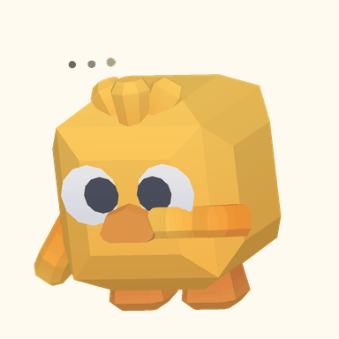
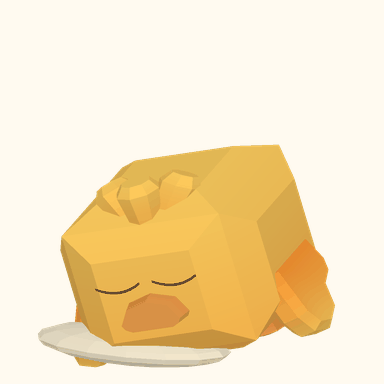

<p align="center">
  
</p>

# 米花 Mihua

一只陪你学习、研究和整理日常的小鸡桌宠。米花常驻 Windows 桌面，把番茄钟、待办、聊天、单词拼写和文献笔记放在同一个工作台里。

当前源码版本 **0.5.27**。支持 Windows 10 / 11，开发环境使用 Python 3.11 或 3.12。代码采用 [MIT 许可证](LICENSE)；第三方代码、角色素材与依赖遵循各自的许可证，见 [第三方声明](THIRD_PARTY_NOTICES.md)。

## 可以做什么

| 场景 | 功能 |
| --- | --- |
| 桌面陪伴 | 拖动、摸头、跳跃、睡觉与唤醒；140 / 190 / 240 三档大小 |
| 学习 | 番茄钟、全屏专注与休息计时、专注记录、单词拼写、久坐提醒 |
| 日常 | 本地待办、分类、四档优先级、截止时间与提醒 |
| 聊天 | 自备 API Key、兼容接口、图片和文档附件、随手问浮窗 |
| 研究 | 读取本机 Zotero 元数据、文献阅读列表、来源对照解读、科研日志与图片笔记 |
| 工具箱 | 自定义网页快捷入口、本机文件转换、模型设置 |

<p>
  
  
</p>

**本地待办、计时、拼写和桌宠互动不需要 API Key。** AI 聊天、文献翻译等功能会请求用户选定的模型服务，可能产生服务商费用。当前个人版不提供网络诊断、系统网络修复、手机同步或自动更新；仓库保留的 `Tools` 是独立工具与兼容测试层。

## 从源码运行

下载或克隆本仓库，在仓库根目录打开 PowerShell：

```powershell
py -3.11 -m venv .venv
.\.venv\Scripts\python.exe -m pip install --upgrade pip
.\.venv\Scripts\python.exe -m pip install -r requirements.txt -e ./Tools
.\.venv\Scripts\python.exe app.py
```

也可以双击 `start.bat`；它会在当前目录创建虚拟环境并安装依赖。只使用本地功能时，无需填写模型密钥。需要 AI 时，在米花右键菜单的“工具箱 → 模型设置”中填写自己的服务地址、模型名称与 API Key。

源码启动后仅显示桌宠，单击米花打开主界面；右键“退出米花”可完整退出。源码版的数据保存在本目录 `data/`，打包版的数据保存在程序目录的 `data/`。不要把数据目录上传到 GitHub。

### 可选：文件转换

文件转换依赖固定版本的外部 Filee 引擎，源码仓库不包含其 EXE。需要时运行：

```powershell
.\.venv\Scripts\python.exe packaging/prepare_filee.py
```

脚本下载官方固定版本并核对 SHA-256，安装到被 Git 忽略的 `runtime/`。未准备引擎时，转换窗口会显示组件未就绪，其他功能仍可使用。下载和特定格式的可用性受网络与引擎能力限制，详见 [开发说明](docs/DEVELOPMENT.md)。

## 开发与测试

```powershell
.\.venv\Scripts\python.exe -m pip install -r requirements-dev.txt
.\.venv\Scripts\python.exe -m pytest -q
.\.venv\Scripts\python.exe app.py --chick-self-test
.\.venv\Scripts\python.exe app.py --unified-self-test
.\.venv\Scripts\python.exe packaging/audit_public.py
```

默认测试使用临时数据与模拟服务，排除标记为 `real_smoke` 的真实主机检查。GitHub Actions 在 Windows + Python 3.11 / 3.12 上运行相同测试。CI 配置已提供，首次推送后的实际结果以 Actions 页面为准。

## 项目结构

```text
app.py                 桌宠、动作和 Qt 入口
westie_agent/          工作台、聊天、研究、待办及兼容模块
Tools/                 本地工具子项目与模拟测试
assets/                动作表、原始小鸡模型、图标和阅读资源
tests/                 应用回归测试
packaging/             组件准备、打包、素材生成和公开文件检查
docs/                  使用、开发、发布与隐私说明
.github/               Windows CI、Issue 和 PR 模板
```

`westie_agent` 是历史内部包名；产品名、图标和用户入口均为米花。原始小鸡由 Kenney 以 CC0 发布；完整模型、纹理和原许可均保留，可使用脚本重新生成动作与图标。

## 更多说明

- [使用说明](docs/USER_GUIDE.md)
- [开发与验证](docs/DEVELOPMENT.md)
- [隐私与数据位置](docs/PRIVACY.md)
- [构建与 GitHub 发布](docs/RELEASING.md)
- [首次上传 GitHub](docs/PUBLISHING.md)
- [角色与图标](docs/ARTWORK.md)
- [贡献指南](CONTRIBUTING.md)、[安全问题报告](SECURITY.md)、[更新记录](CHANGELOG.md)

自动更新将在仓库地址和正式 Release 发布方式确定后继续设计；当前源码不包含自动下载或安装逻辑。
